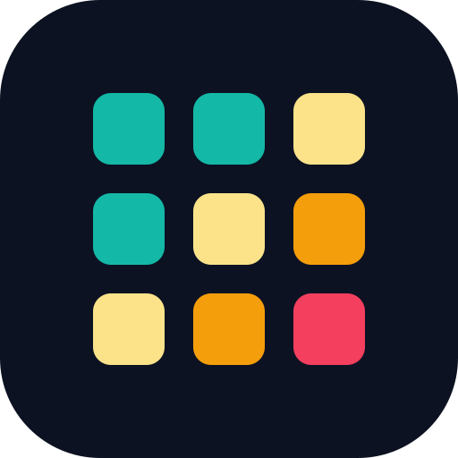

<p align="center"></p>

# ScraperCompany MCP server

[](https://lobehub.com/mcp/scrapercompany)
[](LICENSE)

**166+ live-data tools** for AI agents: hotels, vacation rentals, flights, reviews, cars and attractions, plus Google search/maps, jobs, shopping, property listings, SEC filings, events and more. Price a hotel for the next 330 nights in one call, compare every booking site's price for a stay to the hotel's own website (over 50 booking engines, adding more), pull guest reviews, or search Google Flights — then add other groups when you need them.

This is a **remote** MCP server: there is nothing to install or run. This repository holds the connection settings for each client and a few short examples. The server itself is hosted by ScraperCompany.

- **Server URL:** `https://api.scrapercompany.com/mcp` (Streamable HTTP). Plain `/mcp` is the default set of 24 hotel and flight tools; add groups with `/mcp/g/default,reviews` or use `/mcp/g/travel` (55 read-only travel tools) or `/mcp/g/all` (everything).
- **Sign-in:** OAuth 2.1 in the browser, or an API key in the `x-api-key` header
- **Official MCP Registry:** `com.scrapercompany/travel-data`
- **Docs:** [scrapercompany.com/docs/mcp](https://scrapercompany.com/docs/mcp) · **Pricing:** [scrapercompany.com/pricing](https://scrapercompany.com/pricing)
- **Listings:** [LobeHub](https://lobehub.com/mcp/scrapercompany) · [cursor.directory](https://cursor.directory/plugins/scrapercompany)

## What you can ask

> What are the cheapest nights at The Savoy in London over the next two months?

> Is anyone selling the Park Hyatt Tokyo cheaper than the hotel's own website on 20 November?

> Find Airbnbs in Lisbon for four guests in the first week of December and quote the total for the best three.

> Summarise this month's 1- and 2-star reviews for my hotel and list the ones we haven't replied to.

> Cheapest dates to fly Montreal to Paris in January, and what does that week cost at the hotel near the Louvre I like?

> What are Sixt and DiscoverCars quoting for a week in Rome from FCO next month?

> Show open LinkedIn and Indeed roles for "revenue manager" in Toronto, and the latest 10-K for that hotel group.

## Connect

New accounts get a free trial of 50 calls or 14 days, whichever ends first, with no card. Clients that support OAuth sign you in through the browser, so they need no key. For the others, create a key in the [dashboard](https://api.scrapercompany.com/dashboard).

### Claude (claude.ai, Claude Desktop, mobile)

Add **ScraperCompany** from the [Claude directory](https://claude.ai/directory/scrapercompany), or add a custom connector with the URL `https://mcp.scrapercompany.com/mcp` and sign in. That address shows the read-only travel tools, which suit a chat assistant. If it does not resolve on your network, use `https://api.scrapercompany.com/mcp/g/travel`: it is the same server with the same tools.

### Claude Code

With a key, read from your environment:

```bash
claude mcp add --transport http scrapercompany https://api.scrapercompany.com/mcp --header "x-api-key: $SCRAPERCOMPANY_API_KEY"
```

Without a key, run the command below, then finish the browser sign-in from `/mcp` inside Claude Code:

```bash
claude mcp add --transport http scrapercompany https://api.scrapercompany.com/mcp
```

To share the server with a project, copy [`.mcp.json`](.mcp.json) into it. It reads the key from `SCRAPERCOMPANY_API_KEY`.

### Cursor

Put [`mcp.json`](mcp.json) in `~/.cursor/mcp.json` with your key in place of `${SCRAPERCOMPANY_API_KEY}`. Use the key in Cursor rather than OAuth. This repository is also packaged as a Cursor plugin ([`.cursor-plugin/plugin.json`](.cursor-plugin/plugin.json)), which asks for the key when you install it.

### VS Code (GitHub Copilot)

Copy [`.vscode/mcp.json`](.vscode/mcp.json) into your project. VS Code asks for the key the first time and keeps it in its secret storage.

### ChatGPT

In developer mode, add an MCP server app with the URL `https://api.scrapercompany.com/mcp/g/default`, choose OAuth, and leave the client fields empty: the client registers itself.

### Clients that only run local servers

Use the [`mcp-remote`](https://www.npmjs.com/package/mcp-remote) bridge, for example in `claude_desktop_config.json`:

```json
{
  "mcpServers": {
    "scrapercompany": {
      "command": "npx",
      "args": ["-y", "mcp-remote", "https://api.scrapercompany.com/mcp",
               "--header", "x-api-key:${SCRAPERCOMPANY_API_KEY}"],
      "env": { "SCRAPERCOMPANY_API_KEY": "YOUR_API_KEY" }
    }
  }
}
```

### Check the connection

Listing the tools is free:

```bash
curl -X POST https://api.scrapercompany.com/mcp \
  -H "x-api-key: $SCRAPERCOMPANY_API_KEY" \
  -H "Content-Type: application/json" \
  -H "Accept: application/json, text/event-stream" \
  -d '{"jsonrpc": "2.0", "id": 1, "method": "tools/list"}'
```

A `401` means the key is missing or wrong.

## Tools

The server exposes **166+ tools in 21 groups**. A plain connection to `/mcp` shows the **default set of 24** read-only hotel and flight tools (table below). Add groups in the URL when you need more, for example `/mcp/g/default,reviews,serp` or `/mcp/g/travel` / `/mcp/g/all`. Each tool description states its cost in credits. A call that fails or comes back empty costs nothing.

| Tool | What it does | Credits |
| --- | --- | --- |
| `resolve_hotel` | Find a hotel | 2 |
| `resolve_google_hotel` | Find a hotel by address | 12 |
| `find_hotel_everywhere` | Find a hotel on every booking site | 18 by default; free if nothing is found |
| `hotel_link_ids` | Identify a hotel link | 1 to follow a short link, otherwise free |
| `hotel_destination_search` | Search hotels in a destination | 4 per page; empty pages are free |
| `expedia_find_hotel` | Find a hotel on Expedia | 2 |
| `hotel_rate_calendar` | Hotel nightly rate calendar (up to 330 nights) | 8 |
| `hotel_offers` | Every booking site's price for one stay | 10 (14 with room detail required) |
| `compare_ota_rates` | Compare OTA rates | 30 |
| `expedia_rates` | Expedia rooms and rates | 12 |
| `official_site_rates` | The hotel's own-site rates, including member and points rates | 4 |
| `airbnb_search` | Search Airbnb | 12 |
| `airbnb_priced_calendar` | Airbnb priced availability calendar | 12 plus 1 per night priced (at most 92) |
| `vrbo_search` | Search Vrbo | 2 |
| `vrbo_quote` | Vrbo stay quote | 12 |
| `hotel_guest_reviews` | Google Hotels guest reviews | 2 per page |
| `hotel_reviews_all_sources` | Guest reviews across booking sites | 2 per page per source |
| `flight_search` | Search flights | 4 |
| `flight_next_leg` | Flight return or next leg | 4 |
| `flight_booking_options` | Flight booking options | 5 |
| `flight_location_search` | Find airport or city codes | 2 |
| `flight_price_calendar` | Flight price calendar | 6 |
| `credit_balance` | Credit balance | free |
| `api_catalog` | What this API can do | free |

### More tools, by group

Every tool belongs to a group. A long tool list costs your agent context in every conversation, so a connection only sees the groups named in its URL: `https://api.scrapercompany.com/mcp/g/<group>,<group>`. For example, `/mcp/g/default,reviews` adds every review tool to the default set.

| Group | What it covers |
| --- | --- |
| `catalog` | Credit balance and the endpoint catalog |
| `search` | Hotel name or link to each site's id; destination search |
| `rates` | Google and booking-site prices (Booking.com, Hotels.com, Expedia, Agoda, Tripadvisor, Trivago and more) for a stay or a horizon |
| `official` | The hotel's own website: rates and loyalty ladder across over 50 booking engines |
| `rentals` | Airbnb and Vrbo search, quotes and calendars |
| `reviews` | Guest reviews per source, merged, and response insights |
| `content` | Property details, photos, facilities, nearby places |
| `monitoring` | Saved competitor sets: scheduled rate shopping, parity, history, alerts, exports (changes data) |
| `webhooks` | Webhook endpoints for rate and quota events (changes data) |
| `flights` | Google Flights search, legs, booking options, calendars |
| `cars` | Car-rental offers and their locations |
| `attractions` | Theme-park and attraction day-ticket prices per visit date |
| `serp` | Google Search, News, Maps, Trends and Autocomplete |
| `jobs` | LinkedIn, Indeed, Google Jobs and company careers pages |
| `video` | YouTube search, video details, transcripts, comments, channels |
| `apps` | Google Play and Apple App Store |
| `shopping` | Amazon, Walmart, Target, Google Shopping, TikTok Shop and Shopify |
| `property` | Property listings for sale or rent (Domain, Redfin, Zillow, Centris) |
| `companies` | SEC filings, financials, insider trades, earnings calendar, businesses for sale |
| `marketplace` | Craigslist, Kijiji, Karrot and Etsy listings |
| `events` | Ticket search across SeatGeek, Ticketmaster and StubHub |
| `web` | Any public web page as Markdown, text or HTML |
| `default` / `travel` / `all` | Shortcuts: default set (24), read-only travel set (55), or every tool |

Every tool is annotated. Only the `monitoring` and `webhooks` groups change data, and clients that ask before running write tools will ask before running those.

## Examples

[`examples/`](examples) has three short Python scripts that call the server directly. They use only the standard library, so there is nothing to install:

```bash
export SCRAPERCOMPANY_API_KEY=sk_...
cd examples
python rate_calendar.py "The Savoy" London --days 60 --currency GBP              # 10 credits
python rate_parity.py "The Savoy" London --check-in 2026-11-06 --currency GBP --market GB   # 12 credits
python review_watch.py "The Savoy" London --pages 3 --max-rating 3               # 8 credits
```

`rate_parity.py` prints every seller's price for one night and flags the sellers that undercut the hotel's own website (a real run on 28 October 2026):

```text
The Savoy, 2026-11-06, 1 night, 2 adults, GBP
  Vio.com                      688.99   -16.6% vs direct  <- undercuts the hotel
  Super.com                    696.34   -15.7% vs direct  <- undercuts the hotel
  ...
  Official site                826.50
  Booking.com                  870.00    +5.3% vs direct
```

[`examples/scrapercompany_mcp.py`](examples/scrapercompany_mcp.py) is the whole client: one JSON-RPC POST per tool call. The server is stateless, so there is no session to open first.

Hotel owners can also request a [free rate parity check](https://scrapercompany.com/free-rate-parity-check) without writing any code.

## Pricing

Plans start at $49 a month for 40,000 credits, and credit packs start at $15. A tool call costs the same as the REST API call it wraps. See [pricing](https://scrapercompany.com/pricing) and the [credit cost of every call](https://scrapercompany.com/docs/credits).

## Security

- Keep your key in an environment variable or your client's secret store, not in a config file you share or commit.
- OAuth access tokens last one hour and your client refreshes them. You can revoke a key in the dashboard at any time.
- Report a vulnerability to security@scrapercompany.com.

## Support

support@scrapercompany.com · [Status](https://status.scrapercompany.com/status) · [REST API docs](https://scrapercompany.com/docs)

## License

The configuration files and examples in this repository are MIT licensed. Use of the ScraperCompany service is governed by its [Terms of Service](https://scrapercompany.com/terms).
